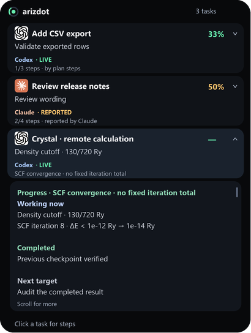

# arizdot

**A small dot for Codex and Claude.** Created by **ariztotell**.

A floating Windows work indicator for **Codex**, **Claude Code**, and **Claude Desktop**. Hover to see concurrent tasks, click a task for its inline subprocesses, and double-click to return to its chat. English and Azerbaijani interfaces are included.

**Use Codex and Claude at the same time:** their tasks appear together in one panel, each with its own progress, provider label and subprocess details. Live updates keep rows in place while you interact with them.

Small **OpenAI / Claude logos** supplied by the project owner and blue / warm copper labels distinguish the assistants. Provider identity stays separate from progress and warning colors. See [asset attribution](docs/ATTRIBUTION.md).

Part of [ariztools](https://github.com/arizmurad/ariztools). **Windows 10/11 · Python 3.11+ · MIT · Preview**



*Illustrative task data rendered by the actual panel; no private conversations are shown.*

[Watch the hover, task expansion and automatic collapse demo](docs/assets/demo.gif).

Unofficial; not affiliated with OpenAI or Anthropic. The OpenAI integration targets local Codex desktop sessions. Ordinary ChatGPT web chats are outside this integration.

## Install

Download a Windows preview ZIP from [Releases](https://github.com/arizmurad/arizdot/releases), extract it into a permanent folder, and double-click **Install-arizdot.cmd**. Python 3.11+ with Tkinter and internet access for dependencies are required. The application does not require an API key or administrator rights.

| Package | What its default installer registers |
| --- | --- |
| Codex | The local Codex arizdot skill |
| Claude | The Claude Code command and Claude Desktop MCP server |
| Both | All integrations |

From a source checkout, double-click **Install-Codex.cmd**, **Install-Claude.cmd**, or **Install-arizdot.cmd** for both. The assistant applications must be installed separately. See [Quick start](QUICKSTART.md), [Codex setup](docs/CODEX.md), or [Claude setup](docs/CLAUDE.md).

Manual setup for both integrations:

```powershell
python -m venv .venv
.\.venv\Scripts\python.exe -m pip install -r requirements-claude.txt
.\.venv\Scripts\python.exe install_codex.py
.\.venv\Scripts\python.exe install_claude.py --code --desktop
```

Setup preserves unrelated integrations and does not enable autostart. Restart your assistant or open a new local session afterward. Keep the extracted application folder in place; installed registrations point to it.

## Activate

| Surface | Invocation | Status source |
| --- | --- | --- |
| Codex desktop | Select arizdot in the skill picker, or `$arizdot` | Local session and explicit navigation records |
| Claude Code terminal / IDE | `/arizdot` | Observed hooks, tools, task plans and waits |
| Local Claude Desktop Code tab | `/arizdot` | The same Code hooks, subject to host policy |
| Ordinary Claude Desktop Chat | `/` → Connectors → Add from arizdot → arizdot | Explicitly reported status and real completed/total counts |

`/arizdot status` reads a Code session. Ordinary Desktop Chat uses MCP tools, or the server's arizdot prompt if the host exposes MCP prompts. Connecting MCP does not start the indicator.

The Codex installer registers the bundled skill under `~/.agents/skills/arizdot`, with an explicit legacy option for older desktop installations. It preserves an existing source junction instead of duplicating its command. CLI equivalents are `python control.py start` and `python control.py status`. Claude invocations pass an explicit provider and session so they cannot collide with Codex IDs.

## Controls

- Hover to expand the 32-pixel dot into a smooth, antialiased status panel.
- Concurrent tasks appear as separate rows with their own progress and freshness. Up to three rows are visible; use the mouse wheel to reach additional tasks.
- Click a task row to expand **Completed / Working now / Next target** inside the panel. Click it again or press Escape to collapse. Scroll inside a long subprocess list to read more. Missing milestones are identified instead of invented.
- Leaving the panel collapses the subprocess and returns to the dot. Each new hover opens the task list with subprocesses closed and scrolling reset.
- A single click on the dot does not open a status window. Tab moves between task rows; Enter or Space expands the focused task.
- Double-click a task row or its expanded subprocess to return to that task. The original click target is retained while the layout updates. Codex opens the exact local chat; Claude Code requests Desktop resume through the installed CLI. If a Claude Desktop monitor has no real chat ID, arizdot asks once for its original `https://claude.ai/chat/...` URL and remembers it. Public `/share/` links cannot reopen the original conversation.
- Drag to move; near either screen center it snaps into alignment.
- Right-click for return-to-chat, language and quit. No separate status window, center-on-screen command, or notification controls are shown.

Run manually with `.\.venv\Scripts\python.exe arizdot.py`. The VBS launcher is also available when the default Python has Pillow. macOS/Linux native rendering is not implemented.

## Progress that means something

Percentages count completed items in an explicitly named plan or batch. They are not remaining-time estimates. Completing a reply does not force an unfinished plan or research project to 100%.

The open subprocess prioritizes **Progress**, current work, completed milestones and the next target. Percentages count named completed milestones. Codex and Claude Code skills can report milestones through a local, conversation-and-turn-bound bridge when no plan tool is available. New actual work supersedes older step labels. Claude Desktop reports replace the previous snapshot; omitted plans do not retain old counts. Milestone reports expire independently of tool activity. Stale sources show **Waiting for a new status update** without presenting old work, a percentage or an old next target as current. Unreported progress remains unknown, and generic tool calls are not displayed as completed project steps.

Configured Quantum ESPRESSO jobs show material, structure, cutoffs, k mesh, SCF iteration, last residual and target, CPU activity, log age, memory waits and audit state. The lower bar counts completed cutoff calculations, including failed validation attempts; pass/fail is shown separately. No linear SCF completion percentage is invented.

Cloud observations replace a stopped local controller only when project metadata records that migration. Observations stay RECORDED or STALE until an actual live source is connected. Remote PIDs are never checked against local Windows processes.

## Data freshness

LIVE means recent events or verified CPU advancement. STALE means no recent evidence. OFFLINE means the source/worker is unavailable or the reader is unresponsive. RECORDED identifies historical evidence or an explicitly model-provided Desktop report. A quiet log alone does not prove a process stopped.

Side notification cards are disabled in the runtime. Status changes remain inside the floating panel. Each task keeps its own source, progress scope and recorded milestones; collecting other tasks does not switch the selected chat or delay its activation.

**Background execution is separate from chat activity.** Registered jobs remain visible across replies and new prompts, using the same file/API/process/service readers for Codex and Claude. A local launch wrapper registers authorized commands automatically; existing work can be attached without restarting it. Independent sources continue updating while the assistant is closed, as long as arizdot stays running. Missing sources/credentials are shown as connection problems. The optional Kaggle connector reads pinned-version status and structured logs. See [Background jobs](docs/BACKGROUND-JOBS.md) for registration, source contracts and limitations.

## Privacy and compatibility

Everything runs locally. arizdot does not upload transcripts or call a model API. Claude hooks record small snapshots, tool names and plan descriptions, not raw shell arguments or user prompts. Optional last assistant messages and all private state stay under `config/`.

Private configuration, backups, virtual environments, private screenshots, caches, logs and machine registrations are excluded from the source archive. Public documentation images under `docs/assets/` and the supplied provider logos under `assets/providers/` are included. The Codex JSONL/navigation adapter is experimental. Claude hook availability depends on the host and policy; remote/WSL sessions and ordinary web-only chats are outside this local integration.

Autostart is disabled in this installation. The optional legacy autostart installer is retained, but skill/MCP invocation never calls it.

## Verify and diagnose

```powershell
.\.venv\Scripts\python.exe doctor.py
.\.venv\Scripts\python.exe -m unittest discover -s tests -v
.\.venv\Scripts\python.exe package_source.py
```

The suite checks provider isolation, concurrent task lists, inline subprocess selection, Codex regressions, Claude events/plans, activation acknowledgements, installer preservation, modern and legacy MCP transports, invalid input and archive privacy. Local protocol/native-UI tests do not replace a signed-in test inside the actual Claude app.

## License

MIT. Forks, modifications and redistribution are welcome with the license notice retained. Changes to the official repository require **@arizmurad**'s review and acceptance. See [Contributing](CONTRIBUTING.md) and [Security](SECURITY.md).
